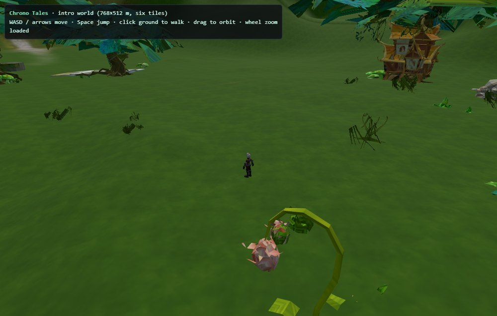

<div align="center">

# Chrono Tales — Browser Revival

**A 2012 MMORPG, running again in a web browser.**

[**▶ Play it now**](https://chrono-tales.apps.workbuddy.host/?sharecode=A3F2VUUMMJ) ·
[Format specification](tools/GPAK_FORMAT.md) ·
[Asset registry](tools/SYSFILEVER.md) ·
[Contributing](#contributing)

</div>



---

## What this is

**Chrono Tales** was a free-to-play 3D MMORPG released in **2012**, built on an
in-house engine called **GBox2**. It ran as a native Windows D3D9 client, shipped
as two `.gpak` archives plus a browser launcher, and is no longer playable — the
servers are gone and the client is abandonware.

The client these tools were written against is the final build, dated
**2013-08-28**, with archives last written **2013-09-26**. Everything here is
derived from that build.

This repository has two halves, and they feed each other:

1. **A playable browser client.** The game's actual terrain, buildings, props,
   textures and player model, decoded out of the original archives and reassembled
   as glTF 2.0, driven by a three.js third-person camera. You walk around the real
   starting zone — not a recreation of it. [It is live
   here](https://chrono-tales.apps.workbuddy.host/?sharecode=A3F2VUUMMJ).
2. **The toolchain that got there.** A complete, tested reverse-engineering suite
   for the GBox2 formats: the archive container, the embedded script language, the
   entity database, the mesh/skeleton/texture formats, the map scenes, and the
   animation clips. Every claim below is pinned by a check that is *proven to fail*
   when the code is wrong.

The point is preservation. Nobody has to guess at these formats again — the
specification is written down, the decoders are in `tools/`, and the whole thing
rebuilds from a copy of the game you already own.

> **No game data is distributed in this repository.** It is source code only. The
> tools operate on the original archives, which you must supply yourself.

---

## Playing it

### In the browser

[**chrono-tales.apps.workbuddy.host**](https://chrono-tales.apps.workbuddy.host/?sharecode=A3F2VUUMMJ)

Controls: **WASD** to move, **space** to jump, **click** to walk somewhere,
**drag** to orbit the camera, **scroll** to zoom.

It is a *world viewer with a character in it*, not a game yet — there is no combat,
no NPCs, no UI and no server. See [what works](#what-works-and-what-doesnt) for the
honest list.

### Locally

The client needs a real HTTP server, because `GLTFLoader` uses `fetch` and
`file://` blocks it:

```bash
python tools/export_web.py                                # build extracted/web/
python -m http.server 8731 --directory extracted/web      # open 127.0.0.1:8731
```

---

## What works, and what doesn't

| | |
|---|---|
| :white_check_mark: | Terrain — all six map tiles stitched into one **768 × 512 m** world (**244,093 triangles**, 25 meshes, 172 m of relief), with layer blending and correct scaling |
| :white_check_mark: | Scenery — trees, rocks, plants, buildings, placed at their original coordinates and orientations |
| :white_check_mark: | The player character — **2,279 vertices** across 7 primitives, correct **1.90 m** scale, skinned to its real 119-bone rig, with body textures |
| :white_check_mark: | Third-person camera that snaps on frame one, follows terrain, and pulls in when it would clip a hill |
| :white_check_mark: | Ground sampling from the decoded heightmap — you walk *on* the terrain, not through it |
| :x: | **Animation.** The character is exported in bind pose. The five clips that ship in the archive belong to a *vehicle* rig, not the human body — see [the note below](#the-character-does-not-animate) |
| :x: | Gameplay — no combat, NPCs, quests, inventory, chat or networking |
| :x: | Other zones — only the starting block is decoded so far |
| :x: | Collision — the camera respects terrain, the player does not respect walls |

### The character does not animate

This is a real limitation, not an oversight, and it is the single most useful thing
a contributor could fix.

The action pack contains five clips (`stand01`, `run`, `jumpstart`, `jumping`,
`jumpdown`). They parse byte-exactly. But they bind to rig `2682c5d5` — a **43-bone
vehicle**: its bones include `Bip01 penqi01..04` ("jets") and `Bip01 F/B Lun`
("front/rear wheel"). Twelve of its bone names do not exist in the 119-bone body
rig, and for the 31 names the two *do* share, the bind pose disagrees on **every
single one** — up to 90° of rotation and 96 cm of offset. Driving the body with
those rotations tore it into a 3.5 m tangle.

So `export_actor` checks rig compatibility and refuses a foreign clip, recording
the reason in `asset.extras.animations_skipped`. Human animation clips exist
somewhere in the original data; they have not been located yet.

---

## Contributing

The most valuable contributions, roughly in order:

1. **Find the human animation clips.** Somewhere in the archives there is an action
   pack bound to the 119-bone body rig. `tools/action_link.py` already maps 481 NPC
   models to action packs — widen it until a human rig turns up.
2. **Decode more of the world.** Six tiles are done; the game shipped many more.
   `tools/map_decode.py` and `tools/zmap.py` are the entry points.
3. **Wire up the entity database to the world.** 42 tables and 19,634 rows are
   decoded — NPCs, items, spawns — but nothing in the client reads them yet.
4. **Give the client physics.** Wall collision, gravity, slopes.
5. **Document a format.** `tools/GPAK_FORMAT.md` is the specification; if you crack
   something new, it goes there.

### Ground rules for a change

This codebase has one hard rule, and it exists because the failure mode here is
*silence*:

> **The client renders a blank canvas with no error when it is broken.** A wrong
> index buffer, a transposed heightmap, a missing `uri` — all of them look
> identical to success until you measure the pixels.

So every structural property must be pinned by an invariant in
`tools/check_all.py` or `tools/export_web.py --check`, and **new invariants must be
proven to fail** by deliberately breaking the code once and watching the check
catch it. A test that has never failed has never been tested.

```bash
python tools/check_all.py             # 21 invariants; exit 1 on any failure
python tools/export_web.py --check    # 8 invariants specific to the web client
```

Both must be green before a pull request. PRs that add a decoder should also add
its regression check.

### Requirements

Python 3.12+, plus `pefile` and `capstone` (disassembly helpers only) and optional
`Pillow` (textured rendering). Everything else is stdlib. No Node build step.

---

## How the revival was done

The pipeline, end to end:

```
gbox/lm_en/*.gpak         the two original archives (you supply these)
        │
        ├── gpak_extract.py      unpack + verify pages, cipher, CRC, name hashes
        │
        ├── varbin_*.py          the entity database: 48 blobs -> 42 tables, 19,634 rows
        ├── varfile.py           SysFileVer.var: 9,975 asset records
        ├── asset_manifest.py    hash -> filename recovery (433/484, 89.5%)
        ├── caf_decode.py        animation clips (byte-exact, 5 clips)
        ├── cmz.py / sbus_*.py   skeletons, bind poses, skinned meshes
        │
        └── map_decode.py        .zmap scenes: height, layers, placements, scenery
                 │
                 ├── render_scene3d.py    textured composed renders (CPU rasteriser)
                 └── export_web.py        glTF 2.0 + height.js + three.js client
                          │
                          └── check_all.py  21 invariants
```

`tools/GPAK_FORMAT.md` is the full specification and findings log — the archive
container, the cipher, the script DSL, the varbin encoder, the skin decode routine
and the coordinate conventions. Read it before touching anything.

### Why the web export is fiddly

Three bugs in the exporter produced *identical symptoms* — a brown canvas — and
none of them raised an error:

- **Per-primitive index buffers.** Each glTF primitive owns its own `POSITION`
  accessor, so indices are primitive-local. A cumulative offset sent the GPU past
  the end of the buffer: 5,700 of 7,000 indices read garbage, and the actor drew as
  a wall of body texture across the frame. Every CPU-side bounds check still said
  1.9 m, because `SkinnedMesh.getVertexPosition()` never touches the index buffer.
- **A transposed heightmap.** `height.js` is indexed in *game* `(x, y)`; glTF is
  Y-up with game `y = −glTF z`. Reading it transposed is invisible at `(128,128)`
  and up to 52 m wrong elsewhere.
- **The camera sampling the terrain at the wrong place.** Combined with headless
  rendering at ~4 fps, the camera was still mid-fly-in when sampled, so it spawned
  inside geometry.

Each is now an invariant. The camera snaps on its first frame, the sampler takes
glTF coordinates and negates once internally, and the index range is checked per
primitive.

### The lesson worth repeating

The actor was reported as a "137-vertex sliver" for two sessions. That was a
misread — the check printed `primitives[0]` only. The actor is 7 primitives and
2,279 vertices, and it was always the right size. **The measurement was wrong, not
the thing being measured.** Several other confident findings in this project
dissolved the same way; they are recorded honestly in `PORT_LOG.md` rather than
quietly deleted, because knowing which conclusions were reached for the wrong
reason is how the next one gets trusted.

---

## Status

| Piece | State |
|---|:--:|
| `.gpak` container (pages, cipher, CRC, MPQ name hash, wrappers) | solved |
| Filename recovery (hash → path) | 433 / 484 (89.5%) — the 51 left are all netpak *containers* (42 `varbin` bundles, 8 `BE119407` tables, `SysFileVer.var`); every asset in both archives now has a path |
| `.gbc` script source (uncompiled GBK DSL, 235 files) | solved |
| `varbin` entity database (48 blobs, 19,640 records) | solved (byte-exact) |
| `varbin` blob → game table (42 tables, 19,634 rows exported) | 42 / 48 (37 editors + 5 editor-less) |
| `varbin` map payloads → `.zmap` scenes (6 tiles = one 768 × 512 m world block) | solved |
| **Write** path: `varbin` encoder + `.zmap` writer | solved — 48/48 payloads re-encode byte-exactly; a map round-trips payload-exact and an edited terrain cell survives the trip. Only the deflate stream differs (2013 zlib vs 1.3.1) |
| `.53wf` mesh geometry | solved |
| `.cmz` skeleton + bind pose | solved |
| `.cmz` `sbus` skinned geometry + index buffer | solved |
| `.caf` character animation (Cal3D `CalCoreAnimation`, 5 clips) | solved (byte-exact); model → clip binding solved, but the only shipped pack is a *vehicle* rig |
| `SysFileVer.var` asset registry (9,975 records) | solved |
| Packer manifest (`0xBE119407`-free `.var`, seed 100) | solved |
| Texture path convention (`model/<GUID>.fw3`, `tex/<GUID>.<ext>`) | solved |
| Texture GUID → filename | solved (5,672 pairs, `tools/guid_names.csv`) |
| Browser client (three.js, terrain + scenery + skinned actor) | **playable**; animation blocked on missing human clips |

The original client binary is `gbox/lm_en/chronotales.exe` (4.1 MB, statically
linked zlib 1.1.3/1.1.4, debug paths pointing at `E:\GBox2\src\...`).

---

## Layout

```
gbox/lm_en/          original game files (not committed - 23 MB of binaries)
extracted/           all derived output (not committed - 88 MB)
  netpak/            archive 1: scripts, entity DB, meshes
  sysnet/            archive 2: UI, tables, textures
  tables/            42 CSVs, 19,634 rows, real column names
  maps/              decoded .zmap scenes (JSON + height/layer PNGs)
  models/            decoded meshes, renders, skin JSON
  web/               the three.js client (glTF + height.js + index.html)
  gbc_index/         browsable script index
  explorer/          one page over all of the above
work/                scratch (not committed)
tools/               the actual work: analysis + decode scripts
docs/                screenshots for this README
```

Only `tools/`, `docs/` and the top-level documents are tracked — 101 files,
about 1.5 MB. Everything large or regenerable is gitignored, because it can all be
rebuilt from these scripts and the original archives:

- `extracted/` (88 MB) — output of the pipeline
- `work/`, `gbox/` (23 MB) — scratch and the original game binaries
- `unins000.*`, `gboxwebruner.dll`, `npgboxruner.dll` — installer leftovers
- `.workbuddy-ai/` — agent session state

`.gitattributes` marks `*.gpak *.gbc *.bin *.png *.jpg *.exe *.dll *.dat` binary;
`* text=auto` means commits normalise to LF while the working copy keeps CRLF, so
the CRLF warnings on Windows are expected and harmless.

---

## Every command

```bash
# archive
python tools/gpak_extract.py verify  gbox/lm_en/netpak.gpak
python tools/gpak_extract.py wrap    gbox/lm_en/netpak.gpak   # compression tags
python tools/gpak_extract.py extract gbox/lm_en/netpak.gpak extracted

# entity database
python tools/varbin_tree.py check        # decode all 48 payloads, assert byte-exact
python tools/varbin_tree.py show 0580853e
python tools/varbin_identify.py          # blob -> game table
python tools/varbin_tables.py            # -> extracted/tables/*.csv
python tools/map_decode.py               # 6 .zmap maps -> extracted/maps/
python tools/build_explorer.py           # -> extracted/explorer/index.html

# asset manifest -> filenames
python tools/asset_manifest.py check     # both manifests decode byte-exactly
python tools/asset_manifest.py stats     # listed vs shipped, per directory
python tools/asset_manifest.py names     # dry run; --apply merges into names.json
python tools/apply_names.py --apply      # rename the extracted tree in place

# asset registry
python tools/varfile.py stats extracted/netpak/SysFileVer.var
python tools/varfile.py csv   extracted/netpak/SysFileVer.var -o manifest.csv
python tools/varfile.py guids extracted/netpak/SysFileVer.var -o guids.csv
python tools/varfile.py xref  extracted/netpak/SysFileVer.var \
                              extracted/netpak/_manifest.csv --merge tools/names.json

# scripts
python tools/gbc_index.py                # -> extracted/gbc_index/index.html

# meshes
python tools/mesh_vert_decode.py         # .53wf -> OBJ
python tools/cmz.py                      # .cmz skeletons -> JSON + bone OBJ
python tools/sbus_decode.py              # .cmz skin -> raw decode
python tools/sbus_obj.py                 # .cmz skin -> OBJ (with UVs)
python tools/sbus_validate.py --strict   # regression test (exit 1 on failure)
python tools/obj_render.py --obj extracted/models/skin_obj \
                           --sheet out.png --up z --size 320 --cols 3

# animation
python tools/caf_decode.py               # .caf clips -> extracted/models/caf/*.json
python tools/caf_decode.py check         # assert byte-exact, all 5 clips
python tools/caf_validate.py --strict    # rig/structural regression test

# maps
python tools/map_decode.py               # 6 .zmap maps -> extracted/maps/
python tools/zmap.py intro518494         # decode one .zmap scene, all sections

# writing maps back (the only write path for map data)
python tools/varbin_write.py check       # 48/48 payloads re-encode byte-exactly
python tools/zmap_write.py check         # 6/6 maps round-trip: payload + decode
python tools/zmap_write.py demo          # edit one cell, prove exactly one changed
python tools/zmap_write.py edit in.zmap out.zmap --raise-cell 64,64,500

# composed scene renders (terrain + scenery + fixed placements, textured)
python tools/render_scene3d.py intro518494            # full tile, 3 angles
python tools/render_scene3d.py intro518494 --close    # crop to the props
python tools/render_scene3d.py --world                # stitch all six tiles
python tools/render_scene3d.py --check                # 4 invariants, exit 1
python tools/render_scenes.py            # flat top-down map of every scene

# web client (three.js): export the world + actor, then verify the export
python tools/export_web.py               # -> extracted/web/ (glTF + height.js + client)
python tools/export_web.py --check       # 8 invariants, exit 1 (silent-failure guard)
python tools/cdp_eval.py URL --js EXPR   # ask the running client what it thinks

# everything at once
python tools/check_all.py                # 21 invariants, exit 1 on any failure
```

All paths are relative to the repo root.

---

## Browsing the extracted data

`extracted/explorer/index.html` is one static page over everything above: the 42
tables with their real column names, the 9,975 asset records, the six decoded
maps with height and terrain previews (led by
`extracted/maps/world_intro_layout.png`, the six tiles stitched into one
768 × 512 m world), the mesh and texture galleries, and the script index.

The composed 3D scene renders land next to them and are browsable from the same
Maps view: `extracted/maps/<tile>_3d_tex_{oblique,plan,horizon}.png` per tile,
`--close` for a crop that frames the props, and `world_intro_3d_tex_*.png` for
the stitched block.

Two CSVs in `extracted/tables/` are **derived cross-references**, not decoded
varbin payloads — `action_links.csv` (481 NPC models → action packs) and
`action_packs.csv` (24 player pack references). They are browsable and marked
with a `derived` chip, but they are excluded from the 42-table / 19,634-row
payload count that `check_all.py` pins.

It has no build step, no dependencies and no server — **double-click it**. Data
is delivered as `window.__X = …` through injected `<script>` tags rather than
`fetch()`, because `fetch` is blocked by CORS on `file://` and script tags are
not. Each table gets its own `data/t_<id>.js` so the 5.7 MB of CSV is loaded on
demand instead of up front.

Views are hash-routed, so a specific table is linkable:
`index.html#t/itemtabedit`, `#maps`, `#assets`, `#scripts`.

Rebuild it after any re-export:

```bash
python tools/varbin_tables.py && python tools/build_explorer.py
```

---

## The web client in detail

`extracted/web/` is the interactive view: the stitched world and the actor as
glTF 2.0, driven by a three.js third-person client (WASD, jump, click to walk,
drag to orbit). `export_web.py` writes it; `height.js` is the world height
sampler the client uses to keep the player on the ground.

three.js is vendored by hand in `vendor/` and is not produced by any script, so
a fresh `extracted/` needs `vendor/three.module.js`, `vendor/GLTFLoader.js` and
`utils/BufferGeometryUtils.js` (r160; the loader imports the latter by a
relative path, so it must sit at `web/utils/`). `export_web.py --check` reports
any that are missing.

Because that client fails *silently*, every structural property it needs is
pinned by `--check`: buffers must carry a `uri`, 100% of the terrain triangles
must face up, `height.js` must be referenced, the three vendored modules must
exist, no primitive may index past its own vertex buffer, `height.js` must be
indexed in game `(x, y)` (with a transposed read shown to be off by tens of
metres), and the camera must snap on its first frame. To capture a frame
headlessly (the plain `--screenshot` flag fires before an async glTF load
finishes, giving a blank canvas):

```bash
python tools/cdp_shot.py "http://127.0.0.1:8731/index.html" out.png \
    --ready "document.getElementById('stat').textContent==='loaded'"
```

`tools/cdp_eval.py` is the companion: it evaluates JS in the loaded page and
prints the value, which is how "the canvas is brown" was turned into "the actor
alone covers 766k of 770k pixels". The client exposes `window.__ct` (scene,
camera, player, sampler, mixer, `setCam()`) for exactly this.

Every figure on the page is read from the generated data (manifests, `_index`
files, `gbc_index/data.json`) rather than hardcoded, so a stale count is
impossible.

---

## Reading the code

Scripts are named by what they attack. The chain that cracked the `sbus` skin
format is representative of the method used throughout — statistics first to find
the structure, then disassembly to confirm the field roles:

```
sbus_analyze.py   autocorrelation + token distance  -> 20-byte record stride
sbus_dump.py      hexdump the header and payload
sbus_fields.py    score every offset as f32 / u16   -> not raw coordinates
sbus_grid.py      lay the payload out on the grid   -> weight field at +0
sbus_decode.py    the decoder (from VA 0x59A640 in the client)
sbus_census.py    which header fields vary, which are constant
sbus_obj.py       OBJ export
sbus_validate.py  four independent checks that the decode is right
```

Two lessons recorded in `GPAK_FORMAT.md` §6 are worth keeping in mind before
trusting a statistical result:

- A test can give the right answer for the wrong reason. "Triangle edges are ~5×
  shorter than shuffled" was **confounded** — index buffers reference numerically
  adjacent vertices, which shortens edges regardless of shape.
- Characterising a byte stream cannot distinguish *encoded* from *quantised*.
  Uniform byte coverage is exactly what a per-mesh quantiser produces. Only the
  decode routine settles it.

---

## Licence and legal

The **source code** in this repository is [MIT licensed](LICENSE).

That licence covers the tools and the client code, and nothing else. It grants no
rights to Chrono Tales itself, its artwork, its data files or its trademarks — all
of which remain the property of their respective owners. **No game data is
distributed here.** The tools operate on a copy of the game that you must already
own, and they will not run without one.

Chrono Tales is a discontinued title; this project exists to keep its world
inspectable after the servers went dark. If you are a rights holder and have a
concern, please open an issue.
